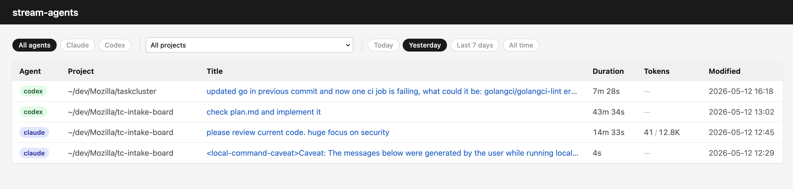
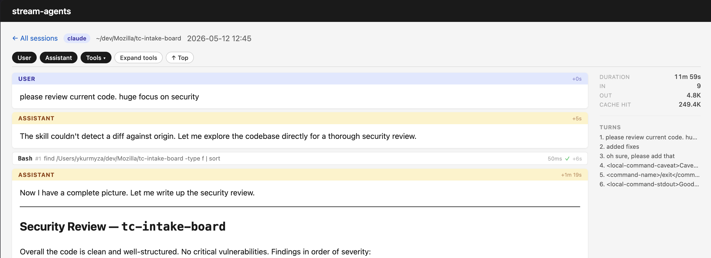

# stream-agents

`stream-agents` is a small local web viewer for AI agent transcripts. It scans
Claude and Codex JSONL sessions plus the OpenCode session database, lists them
by project and modified time, and renders each transcript with Markdown, turn
navigation, and collapsible tool calls.

## Screenshots

Session list:



Transcript view:



## Requirements

- Go 1.23.6 or newer
- Local Claude, Codex, and/or OpenCode transcripts

## Run

```sh
make run
```

`make run` listens on all interfaces (`0.0.0.0:7777`); the binary itself
listens on `http://127.0.0.1:7777` by default. See [Network API](#network-api).

You can also run it directly:

```sh
go run ./cmd/server
```

Useful flags:

```sh
go run ./cmd/server \
  -listen 127.0.0.1:7777 \
  -claude-dir ~/.claude/projects \
  -claude-config-dir ~/.config/claude/projects \
  -codex-dir ~/.codex/sessions \
  -opencode-dir ~/.local/share/opencode
```

### Menu bar

```sh
make tray
```

Adds a menu bar item showing today's and this week's estimated cost across all
agents. The dropdown adds token counts, a per-agent breakdown for today, totals
for this month, last month and the last 3 months, active sessions, and links
into the web UI. Sessions count towards the local day they started. The same data is
served as JSON at `/api/summary.json`. On macOS this build needs cgo (Xcode
command line tools).

### Command line stats

```sh
go run ./cmd/server stats                      # all time, by day, agent, provider and model
go run ./cmd/server stats -group month -breakdown
go run ./cmd/server stats -days 7 -by period,model
go run ./cmd/server stats -from 2026-09-01 -to 2026-09-30 -agent codex -json
```

Prints input, output, cache read/write and total tokens plus estimated cost,
broken down by period (`-group day|month|year`), agent, provider and model.
`-breakdown` lists per-model rows under each period. Sessions count towards the
local day they started. Costs marked `*` include tokens from models without a
known price. The transcript directory flags above also apply.

## What It Reads

- Claude sessions from `~/.claude/projects` and `~/.config/claude/projects`
- Codex sessions from `~/.codex/sessions`
- OpenCode sessions from `~/.local/share/opencode/opencode.db` (or `$XDG_DATA_HOME/opencode/opencode.db`)

OpenCode rows include the exact provider/model recorded on assistant messages;
sessions that switched models show each distinct model used.

OpenCode's stored cost is used when available. Claude and Codex costs are rough
API-equivalent estimates calculated from recorded token usage and a small table
of current standard model prices. Unknown models show no cost. The estimates do
not account for historical price changes or fast, batch, regional, and
long-context pricing modifiers.

Every cost is also shown as **Billed (est.)**: the estimate scaled by a
per-agent multiplier for plans that charge more than API prices. Codex defaults
to `1.75`. Override with `-cost-multiplier codex=1,claude=1.2` or
`STREAM_AGENTS_COST_MULTIPLIER`; listed agents replace the defaults, others bill
at API prices. Usage that never reaches local transcripts (e.g. Codex memories,
cloud tasks) is not included.

The app only reads local transcript storage. See [Network API](#network-api)
before listening on anything but localhost.

## Network API

Read-only JSON endpoints for other programs, e.g. a dashboard that collects
spend from several machines:

- `GET /api/v1/health` returns `{"ok":true,"version":"…","host":"…"}`.
- `GET /api/v1/usage?days=31` returns daily aggregates for the last `days`
  local calendar days, including today (default 31, capped at 400). Each day
  lists one entry per agent and model; days without usage have `"by": []`.

```json
{
  "generated_at": "2026-10-16T12:00:00Z",
  "timezone": "Europe/Berlin",
  "utc_offset": "+02:00",
  "currency": "USD",
  "cost_multipliers": { "codex": 1.75 },
  "days": [
    {
      "date": "2026-10-15",
      "by": [
        { "agent": "claude", "provider": "", "model": "claude-opus-5-5",
          "input_tokens": 1200, "output_tokens": 800,
          "cache_read_tokens": 50000, "cache_write_tokens": 3000,
          "cost": 1.23, "billed": 1.23, "cost_partial": false, "sessions": 2 }
      ]
    }
  ]
}
```

- Days are local calendar days in `timezone`, and sessions count towards the
  day they started, as in `stats` and the menu bar. (The HTML Stats page
  groups by UTC day, so its daily rows can differ near midnight.)
- `cost` is the API-price estimate and `billed` is `cost` times the agent's
  cost multiplier (see above); `cost_partial` means some tokens had no known
  price. `provider` is empty for agents that don't record one (Claude, Codex).
- Numbers match `stats -group day -breakdown` for the same days.
- Requests reuse the in-memory session index: only transcripts that changed
  since the last request are re-read.
- Fields may be added; existing ones are not renamed or removed.

### Listening beyond localhost

`-listen` takes a comma-separated list of addresses (`-addr` is an alias).
The binary defaults to `127.0.0.1:7777`; `make run` and `make tray` listen on
all interfaces (`LISTEN=0.0.0.0:7777`, override with `make run LISTEN=…`).
`0.0.0.0` also covers localhost. When binding one specific IP, add loopback
on the same port so the web UI keeps working in the local browser:

```sh
stream-agents -listen 0.0.0.0:7777                          # all interfaces
stream-agents -listen 127.0.0.1:7777,100.101.102.103:7777   # Tailscale IP only
```

Peers that are not on loopback only reach `/api/v1/*`. Everything else (HTML
pages, transcript streams, `/hot.json`, `/api/summary.json`) answers them with
`403` because it shows prompts and session content. Pass `-allow-remote-ui` to
serve it to remote peers too. There is no CORS and no endpoint that writes or
runs anything. Each `/api/` request logs one line: remote address, method,
path and status.

There is no authentication: `/api/v1/*` is open to anyone who can reach the
port, so only listen on networks you trust (your LAN or tailnet).

```sh
curl http://mac-mini:7777/api/v1/health
curl "http://mac-mini:7777/api/v1/usage?days=7"
```

### Running under launchd (macOS)

Save as `~/Library/LaunchAgents/com.example.stream-agents.plist`, adjusting
the binary path. It runs as your user, so the transcript directories resolve
as usual:

```xml
<?xml version="1.0" encoding="UTF-8"?>
<!DOCTYPE plist PUBLIC "-//Apple//DTD PLIST 1.0//EN" "http://www.apple.com/DTDs/PropertyList-1.0.dtd">
<plist version="1.0">
<dict>
  <key>Label</key><string>com.example.stream-agents</string>
  <key>ProgramArguments</key>
  <array>
    <string>/usr/local/bin/stream-agents</string>
    <string>-listen</string><string>0.0.0.0:7777</string>
  </array>
  <key>RunAtLoad</key><true/>
  <key>KeepAlive</key><true/>
  <key>StandardErrorPath</key><string>/tmp/stream-agents.log</string>
  <key>StandardOutPath</key><string>/tmp/stream-agents.log</string>
</dict>
</plist>
```

```sh
launchctl bootstrap gui/$(id -u) ~/Library/LaunchAgents/com.example.stream-agents.plist
launchctl kickstart -k gui/$(id -u)/com.example.stream-agents   # restart after changes
```

Binding a specific IP such as a Tailscale `100.x` address fails if the
interface isn't up yet at login. `KeepAlive` retries, but `0.0.0.0` avoids the
problem. Days are computed in the system time zone; set `TZ` under
`EnvironmentVariables` to override it.

## Development

```sh
make test
make build
make clean
```

Project layout:

- `cmd/server`: HTTP server entry point
- `internal/store`: Claude/Codex/OpenCode transcript discovery and parsing
- `internal/server`: routes, templates, and static assets
- `internal/render`: Markdown rendering

## Stats

Open **Stats** in the navigation (at `/stats`) for year, month, or day summaries
and an agent breakdown. Filter by project, agent, and inclusive date range.
Metrics include sessions, agent types, projects, transcript records, token usage
(input, output, cache reads/writes), stored cost estimates, and elapsed session duration.
Sessions are assigned to their start date in UTC, falling back to file modification
time when unavailable. Token coverage is shown because some transcripts omit usage.

Daily activity heatmaps show session counts for every year with matching data,
newest first, with
per-day session, token, and agent totals on hover or keyboard focus. It respects
the stats filters and uses UTC session start dates.

Both the chat list and Stats show **Active time (est.)** alongside chat duration.
Active time connects consecutive transcript timestamps when their gap is at most
15 minutes; longer gaps and isolated events contribute zero. This includes agent
work and does not measure human attention. Stats merge overlapping activity across
matching chats, so per-chat and per-agent values need not sum to the overall total.
Activity is split at midnight UTC and clipped to date filters, including activity
from older resumed sessions. Session counts, tokens, and chat duration retain their
session-start grouping.

Set the idle cutoff at startup, for example `go run ./cmd/server -idle-cutoff 10m`.
The cutoff must be positive. Historical transcripts are recalculated automatically.
